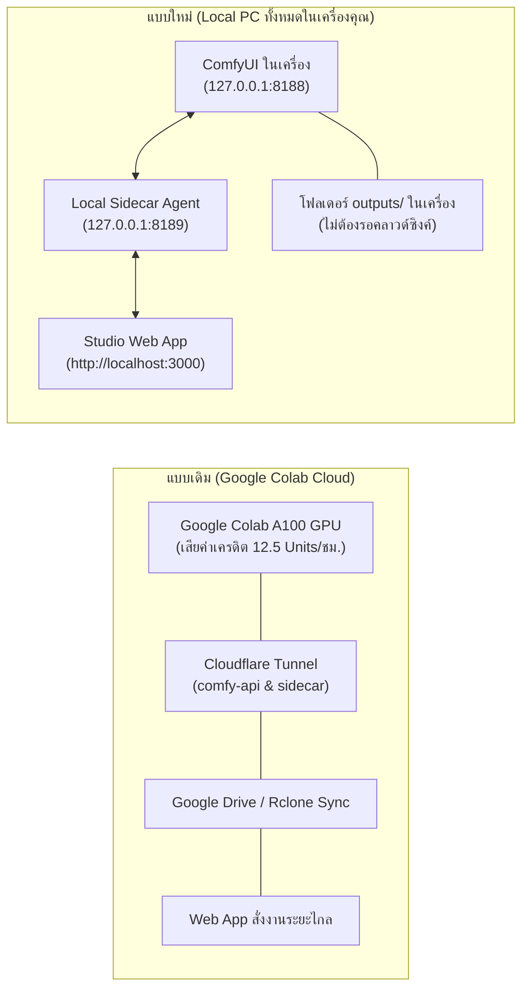

# 🎬 คู่มือการย้ายระบบ Comfy-Colab ลงเครื่อง Windows ปัจจุบัน (Local PC Migration Guide)

คู่มือนี้สรุปขั้นตอนการย้ายระบบ **ComfyUI MiniMax-H3 Video Studio** จาก Google Colab มาติดตั้งและรันบนเครื่องคอมพิวเตอร์ของคุณ (Windows PC + NVIDIA GPU) เพื่อให้สามารถผลิตวิดีโอพร้อมเสียงสเตอริโอคุณภาพสูงได้โดยตรง **ฟรี 100% ไม่จำกัดจำนวนคลิป และไม่ต้องพึ่งพาคลาวด์หรือ Cloudflare Tunnel อีกต่อไป**

---

## 1. การเปลี่ยนแปลงสถาปัตยกรรม (Architecture Comparison)



---

## 2. ความต้องการของระบบ (Hardware & System Requirements)

* **ระบบปฏิบัติการ:** Windows 10 หรือ 11 (64-bit)
* **การ์ดจอ (GPU):** NVIDIA RTX พร้อม Driver ล่าสุด (รองรับ CUDA 12.1 ขึ้นไป)
  * **24GB VRAM (แนะนำสูงสุด):** RTX 3090, RTX 4090, RTX 5090, A5000 / A6000 (รันได้เร็วสุด คลิป 5 วิ ~60–90 วินาที)
  * **12GB – 16GB VRAM:** RTX 3060 12GB, RTX 4070, RTX 4070 Ti, RTX 4080 (รันได้ผ่านระบบ Dynamic Model Offloading ของ ComfyUI)
* **แรมระบบ (System RAM):** แนะนำ **32 GB ขึ้นไป** (จำเป็นสำหรับการสลับโมเดล Text Encoder 15GB ระหว่าง RAM และ VRAM)
* **พื้นที่จัดเก็บ (Storage):** พื้นที่ว่างบน SSD อย่างน้อย **50 – 70 GB**
* **ซอฟต์แวร์ที่ต้องมีในเครื่อง:**
  1. [Node.js](https://nodejs.org/) (เวอร์ชัน 18 ขึ้นไป สำหรับรัน Studio Web App)
  2. [Git for Windows](https://git-scm.com/download/win)
  3. [FFmpeg](https://ffmpeg.org/download.html) (จำเป็นสำหรับการตัดเฟรมท้ายและรวมคลิปวิดีโอ)

---

## 3. ขั้นตอนการติดตั้งและตั้งค่า (Step-by-Step Setup)

### ขั้นตอนที่ 1: ติดตั้ง Custom Nodes ลงใน ComfyUI ของคุณ

ในโฟลเดอร์โปรเจกต์ มีสคริปต์อัตโนมัติสำหรับติดตั้ง Custom Nodes ที่จำเป็นทั้งหมด:
1. ดับเบิลคลิกไฟล์ **`scripts\setup_custom_nodes.bat`**
2. ระบบจะให้ระบุ Path ของโฟลเดอร์ ComfyUI ในเครื่องคุณ (เช่น `C:\ComfyUI_windows_portable\ComfyUI`)
3. สคริปต์จะทำการ Clone และติดตั้ง Dependencies ให้โดยอัตโนมัติ:
   * `ComfyUI-MiniMax-H3-Turbo` (โหนดสร้างภาพและเสียง MiniMax)
   * `ComfyUI-VideoHelperSuite` (โหนดรวมวิดีโอ VHS_VideoCombine)
   * `ComfyUI-KJNodes` (โหนดเสริมสำหรับจัดการภาพและวิดีโอ)
   * `ComfyUI-MiniMax-H3-PDD-Acc` (โหนดเร่งความเร็ว)
   * แพ็กเกจสำหรับ Sidecar (`fastapi`, `uvicorn`, `pydantic`, `requests`)

> **ติดตั้งด้วยตนเอง (Manual Alternative):**
> เปิด Terminal ในโฟลเดอร์ `<ComfyUI>\custom_nodes\` แล้วรันคำสั่ง:
> ```bash
> git clone https://github.com/Larryvrh/ComfyUI-MiniMax-H3-Turbo.git
> git clone https://github.com/Kosinkadink/ComfyUI-VideoHelperSuite.git
> git clone https://github.com/kijai/ComfyUI-KJNodes.git
> git clone https://github.com/Jalen-Brunson/ComfyUI-MiniMax-H3-PDD-Acc.git
> ..\python_embeded\python.exe -m pip install -r ComfyUI-VideoHelperSuite\requirements.txt
> ..\python_embeded\python.exe -m pip install fastapi uvicorn pydantic requests
> ```

---

### ขั้นตอนที่ 2: ดาวน์โหลดโมเดล MiniMax-H3 ลงโฟลเดอร์ `models/`

สามารถเลือกดาวน์โหลดได้ 2 วิธี:

#### วิธีที่ 2.1: ดาวน์โหลดอัตโนมัติผ่านสคริปต์ (แนะนำ)
ดับเบิลคลิกไฟล์ **`scripts\download_models.bat`** 
สคริปต์จะดาวน์โหลดไฟล์และนำไปวางไว้ในโฟลเดอร์ย่อยที่ถูกต้องให้โดยอัตโนมัติ (หากเน็ตหลุด สามารถเปิดสคริปต์ใหม่เพื่อดาวน์โหลดต่อจุดเดิมได้ทันที)

#### วิธีที่ 2.2: ดาวน์โหลดด้วยตนเองผ่าน Web Browser หรือ IDM
หากต้องการดาวน์โหลดเอง ให้โหลดไฟล์ตามตารางด้านล่างนี้ และนำไปวางในโฟลเดอร์ที่ระบุใน ComfyUI ของคุณ:

| โฟลเดอร์ปลายทางใน ComfyUI | ชื่อไฟล์โมเดล | ขนาด | ลิงก์ดาวน์โหลด (HuggingFace) |
| :--- | :--- | :--- | :--- |
| `models/text_encoders/` | `qwen3vl_32b_minimax_h3_nvfp4_awq.safetensors` | 14.9 GB | [ดาวน์โหลด Text Encoder](https://huggingface.co/Comfy-Org/MiniMax-H3/resolve/main/text_encoders/qwen3vl_32b_minimax_h3_nvfp4_awq.safetensors) |
| `models/diffusion_models/` | `minimax_h3_fl2va_pruned_int8_convrot.safetensors` | 19.9 GB | [ดาวน์โหลด Diffusion Model](https://huggingface.co/Comfy-Org/MiniMax-H3/resolve/main/diffusion_models/minimax_h3_fl2va_pruned_int8_convrot.safetensors) |
| `models/vae/` | `minimax_h3_video_vae_fp16.safetensors` | 4.9 GB | [ดาวน์โหลด Video VAE](https://huggingface.co/Comfy-Org/MiniMax-H3/resolve/main/vae/minimax_h3_video_vae_fp16.safetensors) |
| `models/vae/` | `minimax_h3_audio_vae_fp32.safetensors` | 577 MB | [ดาวน์โหลด Audio VAE](https://huggingface.co/Comfy-Org/MiniMax-H3/resolve/main/vae/minimax_h3_audio_vae_fp32.safetensors) |
| `models/loras/` | `minimax_h3_turbo_4step_ema_ckpt850.safetensors` | 743 MB | [ดาวน์โหลด Turbo LoRA](https://huggingface.co/larryvrh/MiniMax-H3-Turbo-Lora/resolve/main/minimax_h3_turbo_4step_ema_ckpt850.safetensors) |

*(โมเดลเสริมสำหรับโหมด NSFW & Motion Mimic):*
* `models/diffusion_models/minimax_h3_hybrid_fl2va_ref2va_b25-49-int8.safetensors` (19.9 GB)
* `models/loras/MysticXXX_MMH3-V4.safetensors` (700 MB)

---

### ขั้นตอนที่ 3: ตรวจสอบการติดตั้ง FFmpeg

เปิด Command Prompt (CMD) แล้วพิมพ์:
```cmd
ffmpeg -version
```
* หากขึ้นเวอร์ชัน FFmpeg แสดงว่าพร้อมใช้งานแล้ว
* หากขึ้นว่า `is not recognized as an internal or external command`:
  1. ดาวน์โหลด FFmpeg จาก [gyan.dev FFmpeg Builds](https://www.gyan.dev/ffmpeg/builds/ffmpeg-git-essentials.7z)
  2. แตกไฟล์ไว้ที่ `C:\ffmpeg`
  3. เพิ่ม `C:\ffmpeg\bin` ลงใน **System Environment Variables (PATH)**

---

### ขั้นตอนที่ 4: การเปิดรัน ComfyUI บนเครื่องของคุณ

แนะนำให้เปิดรัน ComfyUI ด้วย Parameter ที่ปรับแต่งหน่วยความจำ VRAM ให้เหมาะสมกับการ์ดจอของคุณ:

* **สำหรับการ์ดจอ VRAM 24GB (RTX 3090 / 4090):**
  ```cmd
  run_nvidia_gpu.bat --reserve-vram 2.0 --fast
  ```
* **สำหรับการ์ดจอ VRAM 12GB – 16GB (RTX 3060 12GB / 4070 / 4080):**
  ```cmd
  run_nvidia_gpu.bat --lowvram --reserve-vram 3.0 --fast
  ```
*(ComfyUI จะเปิดทำงานที่ `http://127.0.0.1:8188`)*

---

### ขั้นตอนที่ 5: เริ่มต้นระบบ Studio Web App & Local Sidecar

1. ดับเบิลคลิกไฟล์ **`start_studio_local.bat`** ในโฟลเดอร์โปรเจกต์
2. สคริปต์จะเริ่มทำงาน 3 ส่วนพร้อมกัน:
   * **Local Sidecar Agent** (พอร์ต 8189) — จัดการคุม GPU ในเครื่อง, ดึงเฟรมท้าย และรวมวิดีโอ
   * **Studio Web App** (พอร์ต 3000)
   * เปิดเว็บบราวเซอร์ไปที่ **`http://localhost:3000`** อัตโนมัติ
3. หน้าเว็บจะเชื่อมต่อเข้ากับ ComfyUI (`127.0.0.1:8188`) และ Sidecar (`127.0.0.1:8189`) ทันที พร้อมแสดงสถานะ **`Local PC Mode`** และแสดงปริมาณ VRAM ของการ์ดจอคุณแบบ Real-time!

---

## 4. วิธีการสั่งสร้างคลิปวิดีโอ (Usage Workflow)

1. **เลือกโหมดงาน:**
   * **TikTok Commercial Ads (9:16):** สัดส่วนแนวตั้ง `576x1024`, 8 Steps พร้อมเสียงบรรยากาศคมใส
   * **NSFW & Motion Mimic:** สำหรับใช้ภาพและคลิปต้นแบบท่าทาง
   * **Music Video Studio (16:9):** สัดส่วนแนวนอน ภาพยนตร์พร้อมเสียงเพลงสเตอริโอ
2. **ใส่คำสั่ง Prompt:**
   * ช่อง **Visual Prompt:** ระบุฉาก แสง ตัวละคร และการเคลื่อนไหว
   * ช่อง **Audio Prompt:** ระบุเสียงประกอบ เช่น `clear energetic dialogue, studio music, warm acoustic background`
3. **การสั่งสร้างคลิปยาวต่อเนื่อง (Multi-Shot Sequential):**
   * ระบบสามารถต่อความยาวคลิปได้ (5s + 5s + 5s = 15s) โดย Sidecar จะสั่ง FFmpeg ดึงภาพเฟรมสุดท้ายของช็อตแรกไปใส่ในโหนด Image-to-Video ของช็อตที่สอง และรวมคลิปให้เป็นไฟล์เดียวลงในโฟลเดอร์ `output/` ให้อัตโนมัติ

---

## 5. การแก้ไขปัญหาที่พบบ่อย (Troubleshooting)

### 1. เกิดข้อผิดพลาด `CUDA out of memory` (OOM)
* **สาเหตุ:** การ์ดจอ VRAM มีขนาด 12GB–16GB แต่ไม่ได้ใส่แฟล็กจัดการหน่วยความจำ
* **วิธีแก้:** ปิด ComfyUI แล้วเปิดใหม่โดยเพิ่มแฟล็ก `--lowvram` เช่น:
  ```cmd
  python main.py --lowvram --reserve-vram 3.0 --fast
  ```
  และใน Web App แนะนำให้ปรับขนาดความละเอียดเป็น `576x1024` (แทนที่จะเป็น 768x1344)

### 2. สถานะบนหน้าเว็บขึ้นว่า `Local ComfyUI Offline`
* **สาเหตุ:** ยังไม่ได้เปิด ComfyUI หรือพอร์ตไม่ตรง
* **วิธีแก้:** ตรวจสอบว่าเปิด ComfyUI ที่พอร์ต 8188 เรียบร้อยแล้ว (ลองเปิด `http://127.0.0.1:8188` ในบราวเซอร์เพื่อเช็ค) จากนั้นกดปุ่ม **Reconnect** บนหน้าเว็บ

### 3. ขึ้นว่า `FFmpeg is not installed or not in PATH` ตอนรวมคลิป
* **วิธีแก้:** ติดตั้ง FFmpeg ตามขั้นตอนที่ 3 และตรวจสอบว่าสามารถรันคำสั่ง `ffmpeg` ใน Terminal ได้

### 4. ขึ้นเตือน `lora shape '[96768, 8]' is invalid` ใน Log
* **ไม่ต้องกังวล:** นี่เป็นพฤติกรรมปกติของโมเดล MiniMax-H3 INT8 ร่วมกับ LoRA 8-step โดย ComfyUI จะข้ามเฉพาะเลเยอร์ `adaln_proj` และแพตช์เลเยอร์ Attention ที่เหลือ ทำให้สามารถสร้างวิดีโอคุณภาพสูงที่ 8 Steps ได้ตามปกติ
