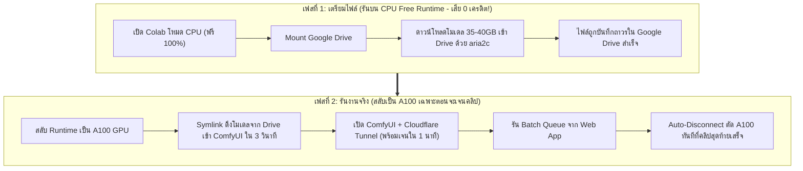

# 🎬 ComfyUI Video Studio (MiniMax-H3 Turbo Uncensored + Colab A100)

ระบบเว็บแอปพลิเคชันสำหรับสร้างคลิปวิดีโอระดับสตูดิโอพร้อมเสียง (Audio-Visual Synthesis) ด้วยโมเดล **MiniMax-H3 Turbo LoRA (Uncensored Workflow)** โดยประมวลผลบน **GPU NVIDIA A100 ของ Google Colab Pro** และจัดเก็บโมเดลถาวรบน **Google Drive** พร้อมระบบตัดการเชื่อมต่ออัตโนมัติ (**Auto-Disconnect Kill Switch**) เพื่อให้ใช้โควต้า **200 Compute Units/เดือน** ได้คุ้มค่าสูงสุด (ผลิตได้มากถึง 600–900 คลิป/เดือน)

---

## 💡 กลยุทธ์ประหยัดเครดิตขั้นสุด (2-Phase Zero-Idle Strategy)

GPU **NVIDIA A100** บน Google Colab ใช้เครดิตประมาณ **12.5 Units ต่อชั่วโมง**
* เครดิต 200 Units = ใช้งาน A100 ต่อเนื่องได้ประมาณ **16 ชั่วโมงต่อเดือน**
* การดาวน์โหลดโมเดล 35–40 GB ใช้เวลา 15–25 นาที หากเปิด A100 ไว้จะเสียเครดิตฟรี ~3-5 Units
* **เราจึงแยกขั้นตอนเป็น 2 เฟสเพื่อไม่ให้เสียเครดิต A100 แม้แต่หน่วยเดียวตอนเตรียมระบบ:**



---

## 🏗️ โครงสร้างโปรเจค (Project Structure)

```text
comfyUI_ A100_project/
├── colab/
│   ├── ComfyUI_A100_MiniMax_H3_Studio.ipynb   # 🚀 สมุดโน้ต Colab (รองรับทั้ง CPU Setup และ A100 Inference)
│   └── colab_sidecar.py                       # 🛡️ Agent คุม VRAM & Kill Switch ตัด Runtime อัตโนมัติ
├── workflows/
│   ├── minimax_h3_turbo_t2v_api.json          # 📄 API Workflow สำหรับ Text-to-Video + Stereo Audio + LoRA
│   └── minimax_h3_turbo_i2v_api.json          # 📄 API Workflow สำหรับ Image-to-Video + Stereo Audio + LoRA
└── webapp/                                    # 🌐 Next.js 14 + TailwindCSS Studio Web App
    ├── src/
    │   ├── app/
    │   │   ├── page.tsx                       # หน้า Studio Dashboard รวมทุกระบบ
    │   │   └── api/proxy/route.ts             # API Proxy เชื่อมต่อ Cloudflare Tunnel แก้ปัญหา CORS
    │   ├── components/
    │   │   ├── Header.tsx                     # แถบแสดงสถานะ A100 VRAM, URL Setup และปุ่มฉุกเฉิน
    │   │   ├── CreditMonitor.tsx              # ตัวจับเวลา A100 และคำนวณเครดิตคงเหลือจาก 200 Units
    │   │   ├── PromptStudio.tsx               # สตูดิโอใส่คำสั่ง Prompt, Audio Prompt, LoRA และปรับ Steps (4-8)
    │   │   ├── BatchQueuePanel.tsx            # ระบบจัดคิวงาน + สั่งปิด Colab อัตโนมัติเมื่อคิวว่าง
    │   │   └── VideoGallery.tsx               # แกลเลอรีเล่นวิดีโอพร้อมเสียง และปุ่มดาวน์โหลด MP4
    │   └── lib/
    │       ├── comfyApi.ts                    # คลาสสื่อสารกับ ComfyUI REST API & Sidecar
    │       └── workflowBuilder.ts             # ตัวแปลงพารามิเตอร์เป็น JSON Node Graph ของ ComfyUI
    └── package.json
```

---

## 🚀 ขั้นตอนการใช้งานทีละขั้นตอน (Step-by-Step Guide)

### ขั้นตอนที่ 1: ดาวน์โหลดโมเดลเข้า Google Drive (รันบน CPU โหมดฟรี - 0 เครดิต)
1. เข้าไปที่ [Google Colab](https://colab.research.google.com/) แล้วเลือกแท็บ **Upload**
2. อัปโหลดไฟล์ [`colab/ComfyUI_A100_MiniMax_H3_Studio.ipynb`](file:///c:/Users/night/Downloads/comfyUI_%20A100_project/colab/ComfyUI_A100_MiniMax_H3_Studio.ipynb)
3. ตรวจสอบให้แน่ใจว่า Runtime เป็น **CPU** (ไม่ต้องเลือก GPU ใดๆ)
4. กดรันเซลล์ในส่วน **[เฟสที่ 1]** ทั้ง 2 เซลล์:
   * เซลล์จะเชื่อมต่อ Google Drive และดาวน์โหลดโมเดล MiniMax-H3 ทั้งหมด (~35-40GB) ด้วย `aria2c` แตก 16 connections
   * ปล่อยทิ้งไว้จนเสร็จ **โดยไม่เสียเครดิตของ Colab Pro แม้แต่หน่วยเดียว**
   * ทำขั้นตอนนี้เพียงครั้งแรกครั้งเดียว ข้อมูลจะถูกเซฟถาวรใน Google Drive

---

### ขั้นตอนที่ 2: เตรียมคิวงานบน Web App (ออฟไลน์)
1. เปิดโฟลเดอร์ `webapp` ใน Terminal บนเครื่องของคุณ:
   ```bash
   cd webapp
   npm run dev
   ```
2. เปิดเบราว์เซอร์ไปที่ [http://localhost:3000](http://localhost:3000)
3. เขียน Prompt, เลือกสไตล์ LoRA, ตั้งค่า Steps (6–8 steps) แล้วกด **"Add to Batch Queue"** ใส่คิวไว้ล่วงหน้ากี่คลิปก็ได้ตามต้องการ

---

### ขั้นตอนที่ 3: สลับเป็น A100 GPU บน Colab (เมื่อจะเริ่มเจนคลิป)
1. บนหน้า Google Colab โน้ตบุ๊ก:
   * ไปที่เมนู `Runtime` -> `Change runtime type`
   * เลือก **A100 GPU** และ **High-RAM**
2. กดรันเซลล์ในส่วน **[เฟสที่ 2]**:
   * ติดตั้ง ComfyUI และ Custom Nodes (~40 วินาที)
   * ดึงโมเดลจาก Google Drive เข้า ComfyUI ผ่าน Symlink (เสร็จใน 2 วินาที)
   * รัน ComfyUI, Sidecar Agent และ Cloudflare Tunnel
3. เมื่อรันเซลล์สุดท้ายเสร็จ จะได้ URL สองชุด:
   ```text
   🔗 1. ComfyUI Endpoint URL : https://xxxx.trycloudflare.com
   🔗 2. Sidecar Kill Switch URL: https://yyyy.trycloudflare.com
   ```
4. นำทั้ง 2 URL ไปใส่ในหน้าต่าง **Connection Settings** บน Web App แล้วกด **Save & Connect**
5. ติ๊กถูกที่ช่อง **"Auto-Disconnect A100 when finished"** แล้วกด **"Start Batch"**
6. ระบบจะเริ่มเรนเดอร์คลิปวิดีโอทีละคลิปอย่างรวดเร็ว (คลิปละ ~45-90 วินาที) และเมื่อคลิปสุดท้ายเสร็จสิ้น **Colab จะสั่งตัด Runtime A100 ทันทีอัตโนมัติ** ป้องกันการกินเครดิตโดยสิ้นเชิง!
