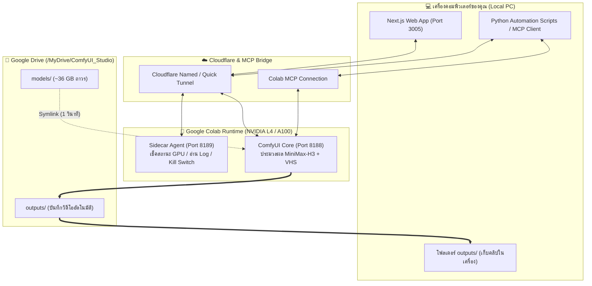
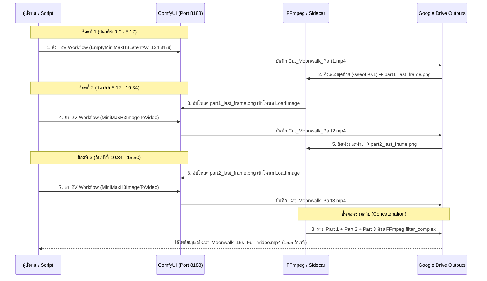

# 🎬 ComfyUI MiniMax-H3 Video Studio — Project Walkthrough & System Guide

เอกสารสรุปสถาปัตยกรรมระบบ วิธีการใช้งาน และกระบวนการทำงาน (Workflow) ทั้งหมดของโปรเจกต์ **ComfyUI Video Studio (MiniMax-H3 Turbo)** สำหรับสร้างวิดีโอพร้อมเสียงสเตอริโอ (Joint Audio-Visual Generation) บน Google Colab GPU (NVIDIA L4 / A100)

---

## 1. ภาพรวมโปรเจกต์ (Project Overview)

โปรเจกต์นี้ออกแบบมาเพื่อผลิตคลิปวิดีโอแนวตั้ง (9:16) และแนวนอน (16:9) คุณภาพสูงพร้อมเสียงประกอบในตัว โดยใช้โมเดล **MiniMax-H3 Turbo (INT8 Quantized)** ร่วมกับ **Google Colab GPU** และจัดเก็บโมเดล/ผลลัพธ์ถาวรบน **Google Drive** โดยไม่ต้องดาวน์โหลดโมเดลใหม่ซ้ำทุกครั้ง

### จุดเด่นของระบบหลังการปรับจูน:
* **Zero-Download Startup:** เชื่อมต่อโมเดลขนาด ~36 GB จาก Google Drive เข้าสู่ ComfyUI ผ่าน Symlink เสร็จภายใน **1 วินาที**
* **รองรับทั้งการ์ดจอ L4 (24GB) และ A100 (40GB/80GB):** ใช้ระบบ Dynamic VRAM Staging โหลดโมเดลสลับระหว่าง System RAM และ GPU VRAM อัตโนมัติ ป้องกันอาการการ์ดจอค้างหรือหน่วยความจำเต็ม (OOM)
* **Sequential Multi-Shot Pipeline (5s + 5s + 5s ➔ 15s):** สร้างคลิปยาวต่อเนื่องโดยการดึงภาพเฟรมสุดท้ายของช็อตก่อนหน้ามาเป็นจุดเริ่มต้นของช็อตถัดไป (Image-to-Video) แล้วนำมาต่อรวมกันด้วย FFmpeg

---

## 2. สถาปัตยกรรมระบบ (System Architecture)



---

## 3. โครงสร้างไฟล์สำคัญในโปรเจกต์ (Project Structure)

* **สมุดโน้ตและเอเจนต์ฝั่ง Colab (`colab/`):**
  * [ComfyUI_A100_MiniMax_H3_Studio.ipynb](file:///c:/Users/night/Downloads/comfyUI_%20A100_project/colab/ComfyUI_A100_MiniMax_H3_Studio.ipynb) — โน้ตบุ๊กหลักสำหรับรันติดตั้งและเปิดเซิร์ฟเวอร์บน Colab
  * [colab_sidecar.py](file:///c:/Users/night/Downloads/comfyUI_%20A100_project/colab/colab_sidecar.py) — เซิร์ฟเวอร์คู่ขนาน (Port 8189) สำหรับเช็คสถานะ GPU, อ่าน Log สด, ดึงเฟรมสุดท้าย, รวมคลิปด้วย FFmpeg และสั่งตัด Runtime อัตโนมัติ
* **เทมเพลต Workflow มาตรฐานที่แก้ไข Bug แล้ว (`workflows/`):**
  * [minimax_h3_turbo_t2v_api.json](file:///c:/Users/night/Downloads/comfyUI_%20A100_project/workflows/minimax_h3_turbo_t2v_api.json) — โครงสร้างคำสั่งสำหรับ Text-to-Video (T2V) พร้อมเสียง
  * [minimax_h3_turbo_i2v_api.json](file:///c:/Users/night/Downloads/comfyUI_%20A100_project/workflows/minimax_h3_turbo_i2v_api.json) — โครงสร้างคำสั่งสำหรับ Image-to-Video (I2V) ต่อเนื่องพร้อมเสียง
* **สคริปต์สั่งงานอัตโนมัติ (`scripts/`):**
  * [generate_cat_video.py](file:///c:/Users/night/Downloads/comfyUI_%20A100_project/scripts/generate_cat_video.py) — สคริปต์สั่งเจนช็อตที่ 1 (Text-to-Video)
  * [generate_part2.py](file:///c:/Users/night/Downloads/comfyUI_%20A100_project/scripts/generate_part2.py) — สคริปต์สั่งเจนช็อตที่ 2 (Image-to-Video จากเฟรมท้ายช็อต 1)
  * [queue_part3.py](file:///c:/Users/night/Downloads/comfyUI_%20A100_project/scripts/queue_part3.py) — สคริปต์สั่งเจนช็อตที่ 3 (Image-to-Video จากเฟรมท้ายช็อต 2)
  * [auto_pipeline.py](file:///c:/Users/night/Downloads/comfyUI_%20A100_project/scripts/auto_pipeline.py) — สคริปต์รันต่อเนื่องอัตโนมัติและรวมไฟล์เป็นคลิป 15 วินาที
* **ระบบหน้าเว็บ (`webapp/`):**
  * [workflowBuilder.ts](file:///c:/Users/night/Downloads/comfyUI_%20A100_project/webapp/src/lib/workflowBuilder.ts) — ตัวสร้างกราฟโหนด ComfyUI สำหรับ 3 โหมดงาน
  * [comfyApi.ts](file:///c:/Users/night/Downloads/comfyUI_%20A100_project/webapp/src/lib/comfyApi.ts) — ตัวจัดการส่งคำสั่งผ่าน API Proxy

---

## 4. รายละเอียดโมเดลและ Workflow การทำงาน

### 4.1 โมเดลทั้ง 3 ส่วนที่ทำงานร่วมกันในทุกการเรนเดอร์
ทุกครั้งที่สั่งเจนคลิป ระบบจะดึงไฟล์จาก `/content/drive/MyDrive/ComfyUI_Studio/models` มาทำงานร่วมกัน 3 ส่วน:
1. **Text Encoder (`CLIPLoader` - type: `minimax`):**
   * `qwen3vl_32b_minimax_h3_nvfp4_awq.safetensors` (14.9 GB) — แปลความหมาย Prompt ทั้งรายละเอียดภาพและบรรยากาศเสียง
2. **Diffusion Model & Acceleration (`UNETLoader` + `LoraLoaderModelOnly`):**
   * `minimax_h3_fl2va_pruned_int8_convrot.safetensors` (19.9 GB) — โมเดลหลักสร้างภาพเคลื่อนไหวและเสียง
   * `minimax_h3_turbo_4step_ema_ckpt850.safetensors` (743 MB) — LoRA เร่งความเร็วให้จบงานได้ใน **8 Steps**
3. **Dual VAE Decoders (`VAELoader`):**
   * `minimax_h3_video_vae_fp16.safetensors` (4.9 GB) — ถอดรหัสสัญญาณภาพผ่านโหนด `VAEDecode`
   * `minimax_h3_audio_vae_fp32.safetensors` (577 MB) — ถอดรหัสสัญญาณเสียงสเตอริโอผ่านโหนด `VAEDecodeAudio`

---

### 4.2 กระบวนการสร้างคลิปยาว 15 วินาที (Sequential 5s + 5s + 5s Workflow)



---

### 4.3 โหมดงานทั้ง 3 Workflows ในหน้าเว็บ Studio (`workflowBuilder.ts`)
1. **`tiktok` (TikTok Commercial Ads):** สัดส่วนแนวตั้ง 9:16 (`576x1024` หรือ `768x1344`), 8 Steps, เน้นความคมชัดของวัตถุและเสียงบรรยากาศคมใส
2. **`nsfw_motion` (Character & Motion Mimic):** ต่อพ่วง LoRA เสริม (`MysticXXX_MMH3-V4.safetensors`) พร้อมรับภาพตั้งต้น (`LoadImage`) และคลิปต้นแบบท่าทาง (`VHS_LoadVideo`)
3. **`music_video` (Music Video Studio):** เน้นการเคลื่อนไหวกล้องแบบภาพยนตร์และซิงค์จังหวะการขยับตัวเข้ากับเสียงดนตรี

> [!IMPORTANT]
> **เทคนิคคุมโทนสีไม่ให้เพี้ยนเมื่อต่อหลายช็อต (Color Consistency Tip):**
> ในการเขียน Prompt สำหรับช็อตที่ 2 และ 3 ห้ามเปลี่ยนคำสั่งสภาพแสงกะทันหัน (เช่น เปลี่ยนจาก `warm cozy indoor lighting` ไปเป็น `studio lighting, cinematic color grading`) เพราะโมเดล Diffusion จะค่อยๆ เปลี่ยนอุณหภูมิสีของฉากตามคำสั่งใหม่ แนะนำให้ใช้ประโยคคุมสภาพแวดล้อมเดิมซ้ำในทุกช็อต เช่น `"same warm cozy indoor lighting, consistent color palette"`

---

## 5. วิธีการใช้งานทีละขั้นตอน (Step-by-Step Usage Guide)

### ขั้นตอนที่ 1: เตรียม Google Colab GPU
1. เปิดหน้า Google Colab แล้วเลือกเมนู **Runtime ➔ Change runtime type**
2. เลือก **Hardware accelerator: GPU**
   * **NVIDIA L4 (24GB VRAM):** แนะนำสำหรับการใช้งานทั่วไป ประหยัดเครดิต (~1.5–2 Units/ชม.) รันคลิป 5 วินาทีใช้เวลาประมาณ 4–5 นาที
   * **NVIDIA A100 (40GB/80GB VRAM):** สำหรับงานเร่งด่วน (~10–12.5 Units/ชม.)
3. กดคลิก **Manage sessions** เพื่อตรวจสอบว่าไม่มีเซสชันเก่าเปิดซ้อนอยู่ (ป้องกัน Cloudflare Tunnel ชนกัน)

### ขั้นตอนที่ 2: รันเปิดเซิร์ฟเวอร์ใน Colab
รันเซลล์ในโน้ตบุ๊กเพื่อทำ 5 ขั้นตอนอัตโนมัติ:
1. Mount Google Drive (`/content/drive`)
2. ติดตั้ง ComfyUI และ Custom Nodes (`ComfyUI-MiniMax-H3-Turbo`, `ComfyUI-VideoHelperSuite`, `ComfyUI-KJNodes`)
3. สร้าง Symlink เชื่อมโมเดลจาก `/content/drive/MyDrive/ComfyUI_Studio/models` เข้าสู่ ComfyUI
4. เปิด **Sidecar Agent** (พอร์ต 8189) และ **ComfyUI Core** (พอร์ต 8188 พร้อมแฟล็ก `--reserve-vram 2.0 --fast`)
5. เปิด **Cloudflare Tunnel** เชื่อมต่อโดเมน `https://comfy-api.ayaigaldie.site` และ `https://sidecar.ayaigaldie.site`

### ขั้นตอนที่ 3: การสั่งเจนคลิป
สามารถเลือกสั่งงานได้ 2 ช่องทาง:
* **ช่องทางที่ 1: สั่งผ่าน AI Agent (MCP) หรือสคริปต์ Python**
  * แจ้งเนื้อเรื่องและรูปแบบคลิปที่ต้องการให้ Agent ทราบ ระบบจะเขียน Prompt, ส่งเข้าคิว `127.0.0.1:8188`, ติดตาม Log การทำงาน, ดึงเฟรมท้าย และรวมไฟล์ MP4 ลงเครื่องให้อัตโนมัติ
* **ช่องทางที่ 2: สั่งผ่าน Web App บนเครื่อง**
  * รันไฟล์ [start_studio.bat](file:///c:/Users/night/Downloads/comfyUI_%20A100_project/start_studio.bat) เพื่อเปิดเว็บที่ `http://localhost:3005`
  * ตั้งค่า Prompt, เลือกสัดส่วน `9:16` (`576x1024`), จำนวน Steps (`8`) แล้วกดเริ่มคิวงาน

---

## 6. สรุปการแก้ไข Bug และปัญหาทางเทคนิค (Troubleshooting & Bug Fixes Log)

| ลำดับ | ปัญหาที่พบ (Issue / Error) | สาเหตุ (Root Cause) | การแก้ไขที่ทำแล้ว (Resolution) |
| :--- | :--- | :--- | :--- |
| **1** | `Required input is missing: weight_dtype / pingpong` | ComfyUI เวอร์ชันใหม่บังคับระบุฟิลด์ใน `UNETLoader` และ `VHS_VideoCombine` | เพิ่ม `"weight_dtype": "default"` และ `"pingpong": false` ลงในไฟล์ JSON ทั้งหมด |
| **2** | `EmptyMiniMaxH3AVLatent not found` | ชื่อโหนดในเทมเพลตเก่าสะกดสลับตำแหน่งตัวอักษร | แก้เป็นชื่อโหนดจริง `EmptyMiniMaxH3LatentAV` และตั้งค่า `CLIPLoader` type เป็น `"minimax"` |
| **3** | `lora shape '[96768, 8]' is invalid` ใน Log | โมเดลหลักถูกบีบอัดเป็น INT8 แต่ LoRA เทรนจาก BF16 ทำให้เลเยอร์ `adaln_proj` ขนาดไม่ตรงกัน | ComfyUI ข้ามเฉพาะเลเยอร์ `adaln_proj` อัตโนมัติและแพตช์เลเยอร์ Attention ที่เหลือ ทำให้เร่งความเร็ว 8 Steps ได้ตามปกติ |
| **4** | `Request failed with status 502` / `value_not_in_list` | เซิร์ฟเวอร์ยังไม่เปิด หรือเปิด Colab หลายเซสชันซ้อนกันด้วย Tunnel Token เดียวกันจนแย่งทราฟฟิก | ปิดเซสชันซ้อน และสั่งรันตรงผ่าน Localhost (`127.0.0.1:8188`) บนเครื่อง Colab |
| **5** | `SameFileError` ตอนก๊อปปี้ไฟล์ลง Google Drive | โฟลเดอร์ `/content/ComfyUI/output` ถูกทำ Symlink ชี้ไปที่ Google Drive อยู่แล้ว | ปรับโค้ดใน [colab_sidecar.py](file:///c:/Users/night/Downloads/comfyUI_%20A100_project/colab/colab_sidecar.py) ให้เช็ค Path ซ้ำก่อนก๊อปปี้ |

---

## 7. ตัวอย่างผลงานจากการทดสอบระบบ (Cat Moonwalk 15s Showcase)

ตัวอย่างการรันจริงจากโปรเจกต์: **"แมวบ้านสีดำเต้นท่า Moonwalk แนวตั้ง 9:16 ความยาว 15.5 วินาที พร้อมเสียงสเตอริโอ"**

````carousel

<!-- slide -->

<!-- slide -->

````

* **ไฟล์วิดีโอตัวเต็มในเครื่อง:** [outputs/Cat_Moonwalk_15s_Full_Video.mp4](file:///c:/Users/night/Downloads/comfyUI_%20A100_project/outputs/Cat_Moonwalk_15s_Full_Video.mp4) (`576x1024`, 24 FPS, H.264 + AAC Stereo, 5.23 MB)
* **ไฟล์ใน Google Drive:** `/MyDrive/ComfyUI_Studio/outputs/Cat_Moonwalk_15s_Full_Video.mp4`
